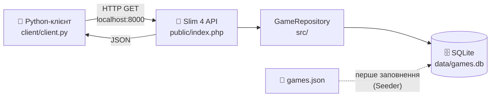

<div align="center">

# 🎮 Online Games API

**REST API про інтернет-ігри на PHP та консольний клієнт на Python**


</div>

---

## 📖 Про проєкт

Навчальний проєкт, що складається з двох частин:

1. **API-сервер** на PHP (мікрофреймворк **Slim 4**, залежності через **Composer**), який віддає дані про популярні інтернет-ігри з бази **SQLite**.
2. **Консольний клієнт** на Python, який отримує ці дані через локальні HTTP-запити та показує їх у зручному меню.

## 🏗 Архітектура



## ✨ Можливості

- 📋 перегляд усього каталогу ігор
- 🔎 пошук за назвою
- 🏷 фільтр за жанром
- 🆓 вибірка безкоштовних ігор (free-to-play)
- 🗄 дані в SQLite, база створюється і заповнюється автоматично
- ⚠️ помилки у форматі JSON (404, 405, 500)

## 📁 Структура проєкту

```
online-games-api/
├── bin/
│   └── seed.php            # ручне заповнення БД
├── client/
│   └── client.py           # консольний Python-клієнт
├── data/
│   ├── games.json          # початкові дані (seed)
│   └── games.db            # база SQLite (створюється автоматично)
├── public/
│   └── index.php           # точка входу, маршрути Slim
├── src/
│   ├── Database.php        # підключення до SQLite, схема
│   ├── GameRepository.php  # запити до таблиці games
│   ├── Response.php        # JSON-відповіді (PSR-7)
│   └── Seeder.php          # імпорт з games.json
├── composer.json
└── README.md
```

## 📦 Залежності (Composer)

| Пакет | Призначення |
|-------|-------------|
| `slim/slim` ^4.12 | мікрофреймворк: маршрутизація, middleware |
| `slim/psr7` ^1.6 | реалізація PSR-7 (запити та відповіді) |
| `ext-pdo`, `ext-pdo_sqlite` | робота з SQLite |

Клієнт на Python використовує лише стандартну бібліотеку, тому нічого встановлювати не потрібно.

## 🚀 Швидкий старт

### Вимоги
- PHP ≥ 8.0 з розширенням `pdo_sqlite` (перевірка: `php -m | grep sqlite`)
- [Composer](https://getcomposer.org/)
- Python ≥ 3.10

### 1. Запуск API
```bash
git clone <URL-репозиторію>
cd online-games-api

composer install
composer start
```
Сервер буде доступний на **http://localhost:8000**. Під час першого запуску база `data/games.db` створюється і заповнюється з `data/games.json`.

Щоб перезаповнити базу початковими даними:
```bash
composer seed
```

### 2. Запуск клієнта
У другому терміналі:
```bash
python client/client.py
```
Якщо API працює на іншій адресі:
```bash
python client/client.py http://localhost:8080
```

## 🔌 Ендпоінти

| Метод | URL | Опис |
|-------|-----|------|
| `GET` | `/` | Інформація про API |
| `GET` | `/api/games` | Список ігор |
| `GET` | `/api/games/{id}` | Одна гра за ID |
| `GET` | `/api/genres` | Список жанрів |

### Параметри `/api/games`

| Параметр | Приклад | Опис |
|----------|---------|------|
| `genre` | `?genre=Shooter` | фільтр за жанром (без урахування регістру) |
| `search` | `?search=dota` | пошук за частиною назви |
| `free` | `?free=true` | `true` лише безкоштовні, `false` лише платні |

Параметри можна комбінувати:
```bash
curl "http://localhost:8000/api/games?genre=Shooter&free=true"
```

### Приклад відповіді `GET /api/games/3`
```json
{
    "id": 3,
    "title": "Counter-Strike 2",
    "genre": "Shooter",
    "developer": "Valve",
    "release_year": 2023,
    "platforms": ["PC"],
    "free_to_play": true,
    "description": "Тактичний командний шутер від першої особи."
}
```

### Приклад відповіді `GET /api/games/999`
```json
{
    "error": "Гру не знайдено"
}
```
Код відповіді: `404`.

## 🖥 Консольний клієнт

Меню та вивід пункту «Усі ігри» (перші п'ять рядків):

```
=== Online Games API ===
1. Усі ігри
2. Інформація про гру за ID
3. Фільтр за жанром
4. Пошук за назвою
5. Тільки безкоштовні
0. Вихід
Ваш вибір: 1
ID  Назва                 Жанр           Рік   Безкоштовна
------------------------------------------------------------
1   League of Legends     MOBA           2009  так
2   Dota 2                MOBA           2013  так
3   Counter-Strike 2      Shooter        2023  так
4   Fortnite              Battle Royale  2017  так
5   World of Warcraft     MMORPG         2004  ні
```

| Пункт | Дія | Запит до API |
|-------|-----|--------------|
| 1 | Усі ігри | `GET /api/games` |
| 2 | Інформація про гру за ID | `GET /api/games/{id}` |
| 3 | Фільтр за жанром | `GET /api/genres`, `GET /api/games?genre=...` |
| 4 | Пошук за назвою | `GET /api/games?search=...` |
| 5 | Тільки безкоштовні | `GET /api/games?free=true` |
| 0 | Вихід | |

Якщо сервер вимкнений, клієнт покаже повідомлення «Не вдалося підключитися… Чи запущено сервер?».

## 🗃 Структура бази даних

Таблиця `games`:

| Поле | Тип | Опис |
|------|-----|------|
| `id` | INTEGER, PK | ідентифікатор |
| `title` | TEXT | назва |
| `genre` | TEXT | жанр |
| `developer` | TEXT | розробник |
| `release_year` | INTEGER | рік виходу |
| `platforms` | TEXT (JSON) | список платформ |
| `free_to_play` | INTEGER (0/1) | безкоштовна гра |
| `description` | TEXT | опис |

## 🛠 Технології

PHP · Slim 4 · Composer · PDO · SQLite · Python (urllib) · JSON

## 📄 Ліцензія

MIT
